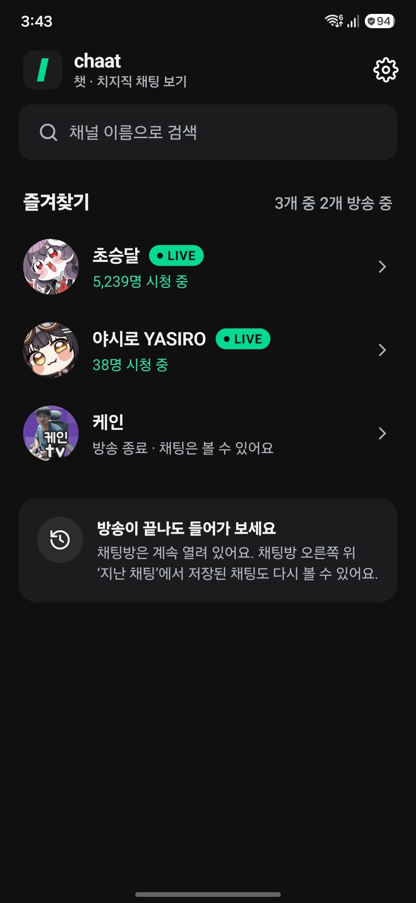
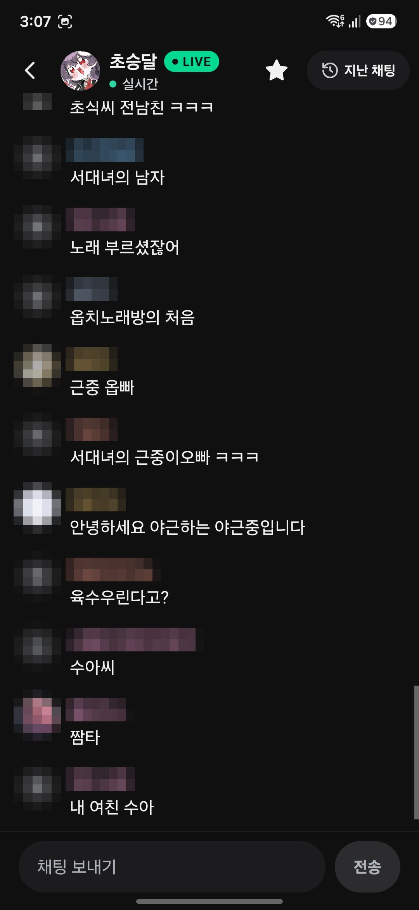
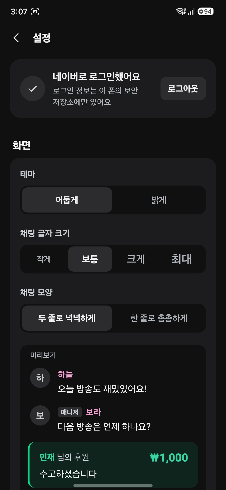

<div align="center">


# chaat (챗)

**치지직 채팅만 가볍게 보는 안드로이드 앱**

영상은 TV나 PC 같은 큰 화면으로 보고, 채팅은 폰으로 편하게 보세요.<br>
방송이 끝나도 채팅방은 그대로 열려 있고, 본 채팅은 폰에 저장돼요.

### [최신 릴리즈 (APK)](https://github.com/ouor/Chaat/releases/latest)

</div>

> [!NOTE]
> **비공식 앱이에요.** chaat은 NAVER, 치지직(CHZZK)과 관련이 없고, 공식으로 제공하거나 승인한 앱이 아니에요. <br/>
> 치지직 웹에서 쓰는 공개되지 않은 API를 사용해서, 치지직이 바뀌면 갑자기 동작하지 않을 수 있어요.

## 📸 이렇게 써요

1. **채널 찾기**: 보고 싶은 채널을 검색해서 별을 눌러 즐겨찾기해요. 홈에서 누가 방송 중인지, 몇 명이 보는지 바로 보여요.
2. **채팅 보기**: 채널을 누르면 실시간 채팅이 열려요. 로그인하지 않아도 볼 수 있어요.
3. **채팅 치기**: 네이버로 로그인하면 채팅을 보낼 수 있어요. 지난 채팅은 채팅방 오른쪽 위 **지난 채팅**에서 다시 봐요.

<div align="center">



</div>
<div align="center"><sub>홈 · 채팅방 · 설정</sub></div>

## ✨ 할 수 있는 것

- **채팅만 가볍게**: 영상 없이 채팅, 후원, 구독, 공지를 봐요. 구독 이모티콘과 프로필 사진도 그대로 보여요.
- **방송이 끝나도 그대로**: 방송이 끝난 채널의 채팅방도 계속 열려 있어요.
- **내 폰에 자동 저장**: 채팅방을 열어 둔 동안의 채팅이 폰에 저장돼요. 날짜별로 다시 보고, 내용이나 닉네임으로 찾을 수 있어요.
- **앱을 내려도 계속**: 홈으로 나가거나 화면을 꺼도 열어 둔 채팅방의 채팅을 계속 받아 저장하고, 새 채팅을 메신저처럼 알림으로 보여 줘요. 설정에서 끌 수 있어요.
- **CSV로 내보내기**: 지난 채팅을 엑셀에서 열 수 있는 CSV 파일로 내보내요. 검색 중이면 찾은 채팅만 담겨요.
- **즐겨찾기**: 자주 보는 채널을 모아 두고, 방송 중인 채널이 위로 올라와요.
- **보기 편하게**: 어두운·밝은 테마, 글자 크기 4단계, 두 줄로 넉넉하게 또는 한 줄로 촘촘하게.
- **위로 올려 읽기**: 지난 채팅을 읽는 동안 새 채팅이 와도 화면이 밀리지 않아요. 새 채팅 개수를 알려 주고, 누르면 맨 아래로 가요.
- **매니저 기능**: 스트리머·매니저 계정이면 공지를 올리거나 내리고, 메시지를 가릴 수 있어요.

### 이럴 때 써 보세요

- TV나 모니터로 방송을 틀어 두고, 채팅은 손에 든 폰으로 보고 싶을 때
- 작업하면서 방송을 틀어 두고, 채팅만 옆에 세워 두고 싶을 때
- 방송이 끝난 뒤에도 공지나 채팅을 놓치고 싶지 않을 때
- "아까 그 채팅 뭐였지?" 하고 지난 채팅을 다시 찾아보고 싶을 때

## ⬇️ 설치하기

1. [최신 릴리즈](https://github.com/ouor/Chaat/releases/latest)에서 `.apk` 파일을 받아요.
2. 받은 파일을 열어요. "출처를 알 수 없는 앱" 안내가 나오면 **설정**을 눌러 이 출처(브라우저나 내 파일)를 허용해요.
3. Play 프로텍트 경고가 뜨면 **세부정보 더보기 → 무시하고 설치**를 눌러요. Play 스토어를 거치지 않은 앱이라 뜨는 안내예요.

**업데이트**는 새 버전 APK를 그대로 설치하면 돼요. 즐겨찾기, 설정, 저장된 채팅은 그대로 남아요.

이 저장소의 [릴리즈](https://github.com/ouor/Chaat/releases)에서 받은 APK만 설치해 주세요. 정식 APK의 서명 인증서 SHA-256 지문은 아래와 같아요.

```
ED:16:EC:D9:93:7F:C4:4D:B1:FF:C6:FE:1C:35:B5:92:16:4B:7F:C1:C4:B2:73:06:88:AE:F8:C5:A2:9A:BF:82
```

PC에서 `apksigner verify --print-certs chaat-*.apk`로 확인할 수 있어요.

### 필요한 것

- Android 7.0 이상, 64비트(arm64) 휴대폰. 2017년 이후 나온 휴대폰은 대부분 해당돼요.
- 인터넷 연결
- 앱 화면은 한국어로 나와요.

## 🔒 개인정보

- 채팅 기록은 **이 폰에만 저장되고, 어디로도 보내지 않아요.** 안드로이드 백업이나 새 폰으로 옮기기(기기 간 전송)에도 들어가지 않아요.
- **비밀번호는 저장하지 않아요.** 로그인은 네이버 공식 로그인 페이지(nid.naver.com)에서 하고, 로그인 뒤 받은 세션 정보만 폰의 보안 저장소에 보관해요. 로그아웃하면 이 폰에서 바로 지워져요.
- 앱은 치지직과 네이버 서버하고만 통신해요.
- 따로 허락을 받는 권한은 **알림** 하나예요. 앱을 내려 둔 동안 새 채팅을 알림으로 보여 줄 때 써요. 허락하지 않아도 채팅은 계속 받아요. 카메라, 위치, 연락처, 저장소 권한은 쓰지 않아요.
- 광고와 분석 도구가 없어요.

## 🙋 자주 묻는 질문

| 이럴 때 | 이렇게 해 보세요 |
|---|---|
| 설치가 안 돼요 | "출처를 알 수 없는 앱" 허용을 확인해 주세요. 32비트 휴대폰이나 Android 7.0 미만에서는 설치되지 않아요. |
| 채팅이 안 보여요 | 한 번도 방송하지 않았거나 채팅이 막힌 채널은 "이 채널은 채팅을 볼 수 없어요"로 나와요. 연령 제한 방송은 성인 인증을 마친 네이버 계정으로 로그인해야 채팅이 보여요. |
| 채팅을 보낼 수 없어요 | 설정에서 로그인했는지 확인해 주세요. 팔로워만, 또는 본인인증한 사람만 채팅할 수 있게 해 둔 채널도 있어요. |
| "다시 연결 중"이 떠요 | 와이파이와 데이터가 바뀌거나 앱을 오래 내려 두면 다시 연결해요. 계속 안 되면 **다시 연결**을 눌러 주세요. |
| 알림이 계속 떠 있어요 | 채팅방을 열어 둔 동안에는 앱을 내려도 채팅을 계속 받을 수 있게 알림이 떠 있어요. 알림의 **그만 받기**를 누르거나 채팅방을 나가면 사라져요. 설정 → 채팅 기록에서 아예 끌 수도 있어요. |
| 앱을 내려 두면 채팅이 끊겨요 | 설정 → 채팅 기록 → **앱을 내려 둔 동안**이 '계속 받기'인지 확인해 주세요. 최근 앱 목록에서 앱을 지우면 받기도 멈춰요. 삼성 휴대폰은 설정 → 배터리에서 chaat을 '제한 없음'으로 두면 더 안정적이에요. |
| 지난 채팅은 어디서 봐요? | 채팅방 오른쪽 위 **지난 채팅**을 눌러요. 채팅방을 열어 둔 동안의 채팅만 저장돼요. |
| 저장 공간이 걱정돼요 | 설정 → 채팅 기록에서 보관 기간(7일·30일·90일·무제한)을 고르거나 모두 지울 수 있어요. |

문제가 계속되면 [이슈](https://github.com/ouor/Chaat/issues)에 휴대폰 기종과 채널 이름을 함께 남겨 주세요.

---

## 🛠️ 개발자 노트

여기부터는 앱을 직접 빌드하거나 고치려는 분을 위한 내용이에요.

- 빌드 (Node.js 20.19+, JDK 17, Android SDK)

  ```bash
  npm install
  npx expo run:android   # 개발 빌드를 휴대폰이나 에뮬레이터에서 실행
  npm run check          # 프로토콜·소켓·CSV 검사
  ```

  릴리스 APK는 개발자 서명 키가 있어야 만들 수 있어요. 키 없이 빌드하면 디버그 키로 서명돼요.
- 쓰인 기술
  - 앱: React Native, Expo (expo-router)
  - 채팅: 치지직 채팅 WebSocket, REST
  - 저장: expo-sqlite, MMKV, react-native-keychain
- 라이선스: [MIT](LICENSE)
